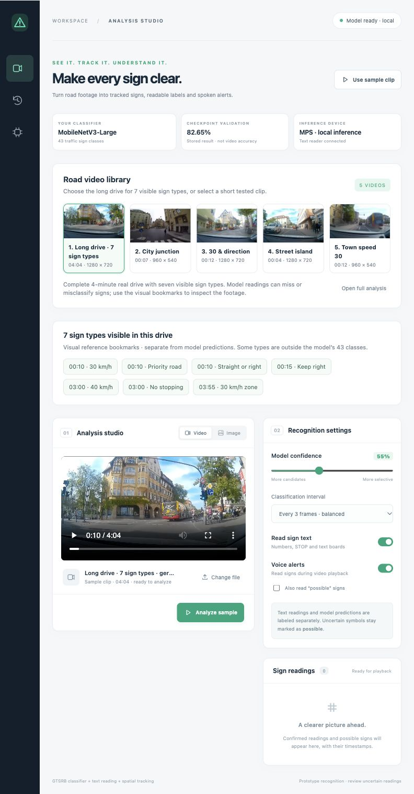
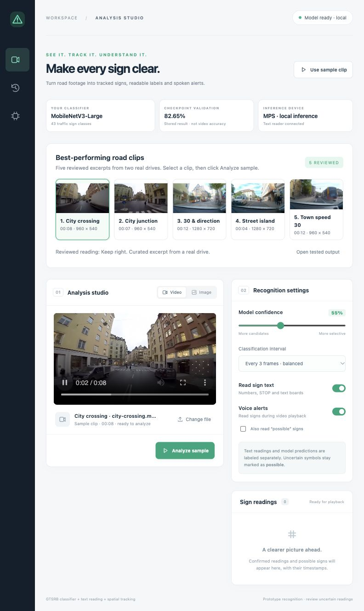
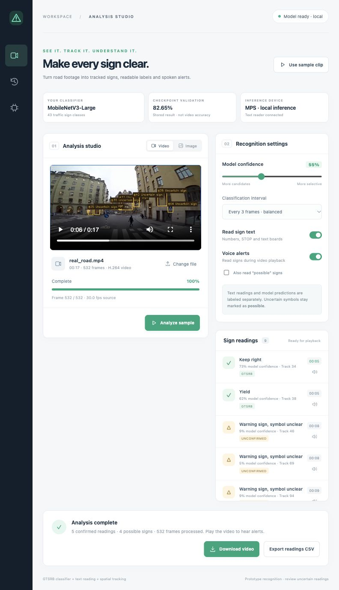

# SignTrace

Traffic sign detection, recognition and voice alerts for road video. SignTrace combines a pretrained **SSD MobileNet** sign localizer, a fine-tuned **MobileNetV3-Large** classifier trained on **GTSRB** (43 classes), **Tesseract OCR** for speed digits and STOP, and a lightweight IoU tracker. A FastAPI backend and a plain HTML/JS frontend serve it all locally.

> Everything runs on your machine. Videos and inference stay local, and the server binds to loopback only.

---

## Contents

1. [Features](#features)
2. [System architecture](#system-architecture)
3. [Dataset: GTSRB](#dataset-gtsrb)
4. [Model architecture](#model-architecture)
5. [Training](#training)
6. [Video pipeline](#video-pipeline)
7. [Repository layout](#repository-layout)
8. [Installation and running](#installation-and-running)
9. [API](#api)
10. [Testing](#testing)
11. [Demo results](#demo-results)
12. [Design decisions](#design-decisions)
13. [Security and privacy](#security-and-privacy)
14. [Troubleshooting](#troubleshooting)
15. [Results and honest limitations](#results-and-honest-limitations)
16. [Roadmap](#roadmap)
17. [Credits and licensing](#credits-and-licensing)

---

## Features

- Upload a video or image, or pick a curated sample clip, and get an annotated H.264 video back.
- Detects and classifies the 43 GTSRB sign types. It reads speed numbers and STOP with OCR, labelled separately from neural predictions.
- Voice alerts through the browser Speech Synthesis API, synchronised to playback.
- Background jobs with progress preview, cancellation and saved history.
- Export of events as CSV or JSON.
- Strict checkpoint loading: `weights_only=True`, SHA-256 identity check, finite-parameter check and a forward-pass check.
- Runs on CPU, CUDA or Apple Silicon (MPS).

---

## System architecture

```
                         ┌──────────────────────────────┐
                         │  Frontend (HTML / CSS / JS)  │
                         │  upload · progress · player  │
                         │  event list · voice alerts   │
                         └──────────────┬───────────────┘
                                        │ REST (relative URLs)
                         ┌──────────────▼───────────────┐
                         │   FastAPI backend (main.py)  │
                         │   routes · uploads · static  │
                         └──────────────┬───────────────┘
                                        │
                         ┌──────────────▼───────────────┐
                         │  jobs.py: background jobs    │
                         │  decode → process → FFmpeg   │
                         │  H.264 encode, progress,     │
                         │  cancel, history             │
                         └──────────────┬───────────────┘
                                        │ per frame
        ┌───────────────────────────────▼────────────────────────────────┐
        │                     vision.py + localizer.py                   │
        │                                                                │
        │  1. LOCALIZE   SSD MobileNet V1 (GTSDB) on overlapping tiles   │
        │                OpenCV DNN, 300×300 input, NMS (IoU 0.35)       │
        │                fallback: HSV colour + shape proposals          │
        │                                  │                             │
        │  2. TRACK      greedy one-to-one IoU matching                  │
        │                                  │                             │
        │  3. CLASSIFY   MobileNetV3-Large (gtsrb_best_model.pth)        │
        │                224×224 crop → 43-way softmax                   │
        │                                  │                             │
        │  4. READ       Tesseract OCR: speed digits, STOP, board text   │
        │                                  │                             │
        │  5. CONFIRM    3 distinct observations → emit event once       │
        └───────────────────────────────┬────────────────────────────────┘
                                        │
                         annotated.mp4 · alerts.csv · events.json
```

### Component roles

| Component | Technology | Role |
|---|---|---|
| Sign classifier | MobileNetV3-Large (PyTorch) | Classifies a cropped sign into one of 43 GTSRB classes. |
| Sign localizer | SSD MobileNet V1, trained on GTSDB, run through OpenCV DNN | Finds sign boxes in full frames. It has three broad groups: prohibitory, mandatory and danger. |
| Text reader | Tesseract via pytesseract | Reads speed digits, STOP and rectangular board text. |
| Tracker | Custom greedy IoU matcher | Keeps one identity per physical sign across frames. No learned tracker. |
| Backend | FastAPI + Uvicorn | REST API, uploads, job queue and static hosting. |
| Encoder | FFmpeg | H.264 / yuv420p / faststart output for browser playback, with source audio kept when present. |
| Frontend | HTML, CSS, JavaScript | UI, byte-range video playback, speech synchronisation. No build step. |

The detector is only a *locator*. Every crop is still classified by the project's own `.pth` model.

---

## Dataset: GTSRB

**German Traffic Sign Recognition Benchmark**, from the Institut für Neuroinformatik, Ruhr-Universität Bochum. It was published for the IJCNN 2011 competition. [Stallkamp et al., *Man vs. computer: Benchmarking machine learning algorithms for traffic sign recognition*, Neural Networks 32, 2012.]

| Property | Value |
|---|---|
| Classes | 43 |
| Training images | **26,640** (as extracted in this project's `data2/gtsrb/GTSRB/Training`) |
| Test images | **12,630** (`Final_Test`, labels in `GT-final_test.csv`) |
| Format | PPM, RGB |
| Image size | Roughly 15×15 to 250×250 px; signs are cropped with a small border |
| Annotation | Per-image `Roi.X1/Y1/X2/Y2` bounding box and `ClassId` (`;`-separated CSV) |
| Structure | Training images are grouped into *tracks*: each physical sign was photographed as a sequence of about 30 frames (`<track>_<frame>.ppm`) |
| Conditions | Varied lighting, motion blur, low resolution, partial occlusion, weather |

Note: the commonly cited full GTSRB training set has 39,209 images. The copy used here contains 26,640 (counted from the extracted folders), alongside the standard 12,630-image test set. I did not verify why the counts differ, so check your download if you need the full set.

### On-disk layout

```
data2/gtsrb/
├── GTSRB-Training_fixed.zip
├── GTSRB_Final_Test_Images.zip
├── GTSRB_Final_Test_GT.zip
├── GT-final_test.csv                 # test labels
└── GTSRB/
    ├── Training/
    │   ├── 00000/ … 00042/           # one folder per class
    │   │   ├── 00000_00000.ppm …     # <track>_<frame>.ppm
    │   │   └── GT-00000.csv          # per-class annotations
    └── Final_Test/Images/            # 12,630 test images
```

> The dataset (692 MB) is **not** committed to this repo. Download it from the [official GTSRB site](https://benchmark.ini.rub.de/gtsrb_dataset.html) and unpack it into `data2/gtsrb/`. `dataset_setup.ipynb` documents the preparation.

### Classes and training-image counts

Counts are the actual number of `.ppm` files per class folder.

| ID | Class | Images | ID | Class | Images |
|---:|---|---:|---:|---|---:|
| 0 | Speed limit 20 km/h | 150 | 22 | Bumpy road | 270 |
| 1 | Speed limit 30 km/h | 1500 | 23 | Slippery road | 360 |
| 2 | Speed limit 50 km/h | 1500 | 24 | Road narrows on the right | 180 |
| 3 | Speed limit 60 km/h | 960 | 25 | Road work | 1020 |
| 4 | Speed limit 70 km/h | 1320 | 26 | Traffic signals | 420 |
| 5 | Speed limit 80 km/h | 1260 | 27 | Pedestrians | 180 |
| 6 | End of speed limit 80 km/h | 300 | 28 | Children crossing | 360 |
| 7 | Speed limit 100 km/h | 960 | 29 | Bicycles crossing | 180 |
| 8 | Speed limit 120 km/h | 960 | 30 | Beware of ice/snow | 300 |
| 9 | No passing | 990 | 31 | Wild animals crossing | 540 |
| 10 | No passing for vehicles over 3.5 t | 1350 | 32 | End of all speed and passing limits | 180 |
| 11 | Right-of-way at next intersection | 900 | 33 | Turn right ahead | 480 |
| 12 | Priority road | 1410 | 34 | Turn left ahead | 300 |
| 13 | Yield | 1440 | 35 | Ahead only | 810 |
| 14 | Stop | 540 | 36 | Go straight or right | 270 |
| 15 | No vehicles | 420 | 37 | Go straight or left | 150 |
| 16 | Vehicles over 3.5 t prohibited | 300 | 38 | Keep right | 1380 |
| 17 | No entry | 750 | 39 | Keep left | 210 |
| 18 | General caution | 810 | 40 | Roundabout mandatory | 240 |
| 19 | Dangerous curve to the left | 150 | 41 | End of no passing | 180 |
| 20 | Dangerous curve to the right | 240 | 42 | End of no passing by vehicles over 3.5 t | 180 |
| 21 | Double curve | 240 | | **Total** | **26,640** |

### Known dataset properties

- **Strong class imbalance.** The largest class (30 and 50 km/h, 1500 each) is 10× the smallest (20 km/h, Dangerous curve left, Go straight or left: 150 each). That is why macro-averaged metrics are reported.
- **Track leakage risk.** Frames of one physical sign are near-duplicates. A naive random split lets the same sign appear in both train and validation, so this project splits by track (see below).
- **Domain gap.** GTSRB is photographed German signs at low resolution. Illustrated or foreign signs and distant, tiny signs in video transfer imperfectly.

---

## Model architecture

### Classifier: MobileNetV3-Large

Verified against the saved checkpoint `gtsrb_best_model.pth`.

| Item | Value |
|---|---|
| Backbone | torchvision `mobilenet_v3_large`, initialised from ImageNet weights for training |
| Parameters | **4,257,115** |
| Head | `Linear 960→1280` → `Hardswish` → `Dropout(0.2)` → `Linear 1280→43` |
| Input | RGB, **224×224** |
| Normalisation | mean `(0.485, 0.456, 0.406)`, std `(0.229, 0.224, 0.225)` |
| Output | 43 logits, softmax at inference |
| Convolutions | 62 Conv2d: 46 × (1×1), 10 × (3×3), 6 × (5×5); 15 of them depthwise |
| Activations | ReLU, Hardswish, Hardsigmoid |
| Other layers | BatchNorm2d, squeeze-and-excitation blocks, adaptive average pooling |
| Checkpoint contents | `model_state_dict`, `model_name`, `num_classes`, `class_names`, `image_size`, `mean`, `std` |
| Stored validation accuracy | **82.65%** (stage 2, epoch 9) |

An optional **ResNet18** (custom head `512→256→43`, ReLU, Dropout 0.30) is implemented in the training notebook as an alternative. It is not the saved or active model.

### Detector: SSD MobileNet V1 (GTSDB)

- Pretrained and **not trained by this project**. Loaded as `models/detection.pb` and `detection.pbtxt` via OpenCV DNN (CPU).
- Input is 300×300 through `blobFromImage` (scale 1.0, BGR→RGB swap).
- Three broad output groups: prohibitory, mandatory and danger. STOP is absent from the detector's groups, so STOP is found separately (see the pipeline).
- Provenance: [MaxRitter/OpenCV_TrafficSign](https://github.com/MaxRitter/OpenCV_TrafficSign), which uses the detector from [aarcosg/traffic-sign-detection](https://github.com/aarcosg/traffic-sign-detection). See `traffic_sign_app/models/SOURCES.md`.

### Text reader: Tesseract

Pretrained, not trained here. Page-segmentation mode 8 is used for isolated digits and mode 6 for general crop text. Digit reads use a numeric whitelist.

---

## Training

Defined in `train_model.ipynb`. Optimizer and loss settings come from the notebook; they are not stored in the checkpoint.

### Data split and preprocessing

- Training/validation split of about **80/20 within each class, grouped by tracking sequence**, to avoid near-duplicate leakage.
- Fixed random seed **42**.
- Evaluation transform: resize 224×224 → tensor → normalise.
- Training augmentation:

| Augmentation | Setting |
|---|---|
| Colour jitter | brightness ±20%, contrast ±20%, saturation ±15%, applied with p = 0.70 |
| Rotation | ±8° |
| Translation | up to 6% |
| Scale | 0.90 – 1.10 |

No horizontal flip is used, because many signs are chirality-specific (turn left/right, keep left/right).

### Two-stage transfer learning

| | Stage 1 | Stage 2 |
|---|---|---|
| Trainable | Classifier head only (backbone frozen) | Last 3 MobileNet feature blocks + classifier |
| Epochs | 3 | up to 10 |
| Learning rate | 1e-3 | backbone 1e-5, head 1e-4 |
| Scheduler | CosineAnnealingLR (T_max = stage epochs) | CosineAnnealingLR |
| Early stopping | n/a | after 4 epochs without validation-accuracy gain |

Shared settings:

| Setting | Value |
|---|---|
| Loss | `CrossEntropyLoss(label_smoothing=0.05)` on raw logits |
| Optimizer | AdamW, weight decay 1e-4 |
| Batch size | 32 |
| Gradient clipping | max norm 2.0 |
| Frozen BatchNorm | frozen backbone BN statistics kept in eval mode |
| Best checkpoint | selected by validation accuracy |

### Evaluation

The notebook computes accuracy, macro precision, macro recall, macro F1, a confusion matrix, a per-class classification report, and train/validation loss and accuracy curves.

---

## Video pipeline

| Stage | Implementation and defaults |
|---|---|
| Localization | SSD on the full frame and overlapping tiles. Detector confidence threshold 0.80. |
| De-duplication | OpenCV NMS, IoU 0.35. The NMS score gate is 0.35 so OCR-confirmed STOP proposals are admitted. |
| STOP support | A compact filled-red colour/shape proposal is accepted only if its pixels OCR as `STOP`. |
| Fallback localization | HSV red/blue/green masks, 3×3 all-ones morphological closing, contours, polygon and circularity tests. This is classical image processing, not a learned kernel. |
| Tracking | Greedy one-to-one IoU matching. |
| Classification | Every **3** frames by default (configurable). All frames are still decoded and written. Confidence threshold **0.55**. Geometry and colour constraints reject incompatible classes. For example, blue board proposals cannot become speed limits. |
| OCR | Refreshed about every 0.45 s per visible track. Readings are labelled **OCR**, not model predictions. |
| Confirmation | A sign is announced after **3 distinct** analysed observations. A cached OCR result cannot count as several observations. Each tracked label is announced once. |
| Output | FFmpeg H.264 / libx264 / yuv420p / faststart. Source audio is kept when present. |
| Speech | Browser Speech Synthesis, following the processed video's playback clock. |

---

## Repository layout

```
SignTrace/
├── README.md
├── PROJECT_MODEL_DETAILS.md         # detailed model/training notes
├── gtsrb_best_model.pth             # trained classifier weights (~17 MB)
├── train_model.ipynb                # training and evaluation
├── dataset_setup.ipynb              # dataset preparation
├── video_sign_alert.ipynb           # notebook client for the backend
├── requirements.txt
├── run_signtrace.sh                 # starts backend + frontend
└── traffic_sign_app/
    ├── backend/
    │   ├── main.py                  # FastAPI routes, frontend hosting
    │   ├── jobs.py                  # background jobs, FFmpeg encoding
    │   ├── vision.py                # checkpoint, preprocessing, OCR, tracking
    │   ├── localizer.py             # SSD detection + NMS
    │   └── samples.py               # curated sample library
    ├── frontend/                    # index.html, style.css, app.js
    ├── models/                      # detection.pb, detection.pbtxt, SOURCES.md
    ├── tests/test_app.py
    ├── notebook_backup/
    ├── VALIDATION.json
    └── README.md                    # app-level notes
```

Not in git (see `.gitignore`): virtual environments, `data2/`, `*.mp4`, and `traffic_sign_app/{runtime,benchmark,samples}/`.

---

## Installation and running

Requires **Python 3.12**, **FFmpeg** and **Tesseract**.

```bash
git clone https://github.com/neevmodh/SignTrace.git
cd SignTrace

python3.12 -m venv .venv312
.venv312/bin/python -m pip install -r traffic_sign_app/requirements.txt
brew install ffmpeg tesseract        # macOS; use apt/choco elsewhere

./run_signtrace.sh
```

Open **http://127.0.0.1:8000** (API docs at `/docs`). Use `PORT=8001 ./run_signtrace.sh` if the port is busy.

Tesseract is optional for classification only, but it is needed for reliable number and STOP reading.

To retrain, install the root `requirements.txt` (Jupyter, scikit-learn, matplotlib), place GTSRB under `data2/gtsrb/`, and run `train_model.ipynb`.

### Using the app

1. Choose a sample clip, or **Change file** to upload a video or image (videos up to 250 MB, images up to 20 MB).
2. Adjust the confidence threshold, frame stride and OCR toggle, then run the analysis.
3. Play the annotated result. Enable **Voice alerts** to hear readings in sync. Low-confidence readings are excluded unless you opt in.
4. Download the video or the CSV/JSON event log.

---

## API

| Method | Endpoint | Purpose |
|---|---|---|
| GET | `/api/health`, `/api/model` | Status and model metadata |
| POST | `/api/jobs` | Upload a video (`threshold`, `stride`, `ocr`) |
| POST | `/api/jobs/demo` | Analyse an allowlisted sample (`sample_id`) |
| GET | `/api/jobs`, `/api/jobs/{id}` | History and progress |
| POST | `/api/jobs/{id}/cancel` | Cancel a running job |
| GET | `/api/jobs/{id}/preview`, `/video`, `/alerts.csv`, `/events.json` | Results |
| POST | `/api/images` | Image scan (`cropped=true` for a pre-cropped sign) |
| GET | `/api/samples` | Sample library metadata |

Model configuration is server-side. Arbitrary weights or paths cannot be uploaded through the frontend.

---

## Testing

```bash
.venv312/bin/python -m pytest -q traffic_sign_app/tests
```

`VALIDATION.json` records 22 application and notebook tests passing. They cover checkpoint loading, OCR, tracker identity and observation counting, API error handling, H.264 frame count, byte-range delivery, cancellation and audio preservation. They use the real checkpoint plus isolated fixtures. They do **not** claim a new accuracy score.

---

## Demo results

Screenshots from the app (`traffic_sign_app/*.png`):





### Sample library

The built-in library has five clips: **Long drive (7 sign types)**, City crossing, City junction, 30 & direction, Street island and Town speed 30. 30 candidate clips from 26 recordings were screened first. The four short examples are non-overlapping excerpts from two real drives, picked to show correct visible readings. They are curated demos, not a held-out benchmark. Full method and rejected clips are in `traffic_sign_app/benchmark/REPORT.md` (local only).

### Full-run example: 4:04 German drive

All 3,663 frames at 15 fps (244.2 s) with threshold 0.55, stride 3, OCR on. The model emitted **11 events, including repeats and mistakes**:

| Time (s) | Output | Source |
|---:|---|---|
| 0.4 | Road work | classifier |
| 7.0 | Speed limit 50 km/h | classifier |
| 9.8 | Speed limit 30 km/h | OCR |
| 12.2 | Keep right | classifier |
| 23.4 | Speed limit 60 km/h | OCR |
| 23.6 | Keep right | classifier |
| 29.8 | Speed limit 30 km/h | classifier |
| 30.4 | Speed limit 30 km/h | classifier |
| 31.4 | Speed limit 50 km/h | classifier |
| 153.8 | Keep right | classifier |
| 235.2 | Speed limit 30 km/h | classifier |

The drive has seven manually verified sign types: 30 km/h, priority road, straight-or-right, keep-right, 40 km/h, no-stopping and a 30-zone sign. The last three are outside the 43 classes. The first reading (Road work) and some 50/60 readings are wrong. The timestamp bookmarks in the UI are manual references, kept separate from model output and never used to produce predictions or speech.

---

## Design decisions

| Decision | Why |
|---|---|
| Separate detector and classifier | The MobileNetV3 model only classifies cropped signs. Full frames need a locator, so a pretrained SSD finds boxes and the project's own weights still decide the class. |
| Overlapping tiles | Signs in dashcam video are small. Tiling keeps distant signs above the detector's resolution. |
| Three-observation confirmation | One-frame misfires on facades, sky or vehicles are common. Requiring three distinct analysed observations suppresses them. |
| OCR labelled separately | Speed digits and STOP are read from pixels, not predicted. The UI shows the source (`gtsrb` or `ocr`) so the two are never confused. |
| Cached OCR cannot vote repeatedly | An earlier version let one reused OCR result count as several observations and trigger false alerts. |
| STOP via red-shape + OCR | The detector has no STOP group. A red proposal is accepted only if it reads `STOP`. |
| Speech on playback clock | Processing runs faster than real time, so voice alerts follow the player, not the job. |
| H.264 re-encode | The original `mp4v` (MPEG-4 Part 2) output would not play in browsers, and dropped frames. FFmpeg now writes every frame as H.264/yuv420p with faststart. |
| Track-grouped validation split | GTSRB frames come in near-identical sequences, so random splits inflate accuracy. |
| No horizontal flip augmentation | It would turn "turn left" into "turn right". |

---

## Security and privacy

- The server binds to `127.0.0.1` only. Nothing is sent to external services.
- The checkpoint is loaded with `weights_only=True` and verified (SHA-256 `303eb43d…9d9407`, strict state-dict match, finite weights, forward pass).
- Upload limits: 250 MB video, 20 MB image. Sample IDs are allowlisted. Clients cannot choose model paths or upload weights.
- Runtime uploads and results stay in `traffic_sign_app/runtime/`, which is git-ignored.

---

## Troubleshooting

| Symptom | Fix |
|---|---|
| `Create a Python 3.12 environment first` | Run the install steps above. The script needs `.venv312`. |
| Port 8000 in use | `PORT=8001 ./run_signtrace.sh` |
| No speed numbers or STOP read | Install Tesseract (`brew install tesseract`) and keep OCR enabled. |
| Result video won't play or encode | Install FFmpeg and make sure it is on `PATH`. |
| No voice alerts | Use Chrome or Safari with an installed English voice, and enable **Voice alerts**. |
| Sample clips missing after cloning | Videos are not in git. Add your own clips or upload a file. |
| Training notebook can't find data | Place GTSRB at `data2/gtsrb/GTSRB/`. |

---

## Roadmap

- Fine-tune on more video-like data and illustrated signs to reduce the domain gap.
- Add classes beyond GTSRB (no-stopping, 40 km/h, zone signs, other countries).
- Build a properly annotated held-out video set and report video-level precision, recall and mAP.
- Train or swap in a detector with a STOP class and finer sign groups.
- Replace greedy IoU matching with a motion-model tracker.

---

## Results and honest limitations

- **82.65% is validation accuracy on cropped GTSRB images.** It is not video detection accuracy. No video-wide mAP, precision or recall is claimed.
- The curated sample clips are hand-picked examples chosen to show correct readings. They are not a held-out benchmark. The full screening of 30 candidates and the rejected clips are in `traffic_sign_app/benchmark/REPORT.md` (local only).
- The 4:04 German long drive contains sign types outside the 43 supported classes (no-stopping, 40 km/h, 30-zone). Emitted event counts are not correct-recognition counts.
- Small or distant signs, poor lighting, occlusion and unfamiliar or illustrated designs can be missed or misread.
- The classifier is trained on photographed German signs. Other countries' signs are not supported.
- Detector and classifier confidences are different scores and are not comparable.

---

## Credits and licensing

- **Dataset:** GTSRB, © Institut für Neuroinformatik, Ruhr-Universität Bochum. Check the dataset's terms before redistribution.
- **Detector:** SSD MobileNet GTSDB graph from [aarcosg/traffic-sign-detection](https://github.com/aarcosg/traffic-sign-detection), via [MaxRitter/OpenCV_TrafficSign](https://github.com/MaxRitter/OpenCV_TrafficSign).
- **Libraries:** PyTorch, torchvision, OpenCV, FastAPI, Tesseract, FFmpeg.
- **Sample footage:** sources in `traffic_sign_app/samples/SOURCES.md` (local). The source repositories do not state an explicit media license, so verify rights before redistributing any footage.
- Project code is released under the [MIT License](LICENSE). The license does not cover GTSRB, the detector graph or the sample footage, which keep their own terms.
